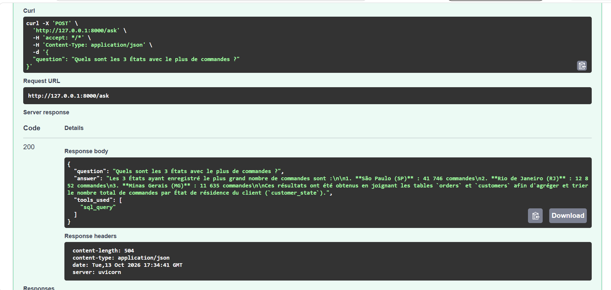
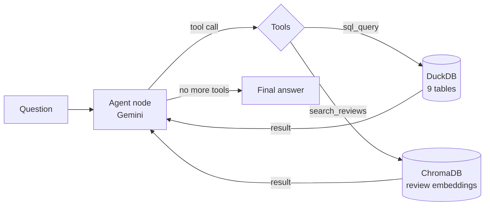

# Olist Copilot 🛒🤖

An AI agent that answers business questions in natural language on the **Olist Brazilian e-commerce dataset** (~100k orders), by combining **text-to-SQL** and **semantic search (RAG)** over customer reviews.

> *"What share of reviews are negative, and why are customers unhappy?"*
> → The agent computes **14.69 %** negative reviews in SQL, then searches the reviews to identify the main causes (late or missing deliveries, damaged products, incomplete orders), quoting real customer reviews.



## Why this project

Business teams often wait for analysts to answer simple data questions. This agent lets anyone ask a question in plain language and get an answer **grounded in the data**: exact figures from SQL, qualitative insights from real customer reviews, and the method used.

## How it works



The agent is a **LangGraph** graph with two nodes:
- **agent**: the LLM (Gemini) reads the conversation and decides to call a tool or to answer;
- **tools**: executes the requested tool and adds the result to the shared state.

It loops *think → act → observe* until it has enough information, and can **self-correct** when a SQL query fails.

| Tool | Data source | Used for |
| --- | --- | --- |
| `sql_query` | DuckDB (orders, customers, payments, reviews…) | Quantitative questions: counts, averages, rankings |
| `search_reviews` | ChromaDB (Gemini embeddings of customer reviews) | Qualitative questions: why customers complain, what they like |

### Guardrails
- SQL is **read-only**: only `SELECT`/`WITH`, forbidden keywords blocked, read-only DB connection, max 50 rows returned.
- **Strict scope**: out-of-scope questions are refused.
- **Step limit** (15) so the agent can never loop forever.

## Evaluation

The agent is evaluated on a **golden dataset** of 12 questions. Each expected answer is computed by a reference SQL query, and an **LLM-as-judge** compares it with the agent's answer.

| Version | Score | Change |
| --- | --- | --- |
| v1 | 11/12 (92 %) | Agent answered an out-of-scope question ("capital of Australia") |
| v2 | **12/12 (100 %)** | Stricter scope rule in the system prompt |

Full report: [`eval/results.md`](eval/results.md). *12 questions is a small test set: the score is indicative, not a guarantee.*

## Tech stack

Python · LangGraph · LangChain · Gemini API · DuckDB · ChromaDB · FastAPI · Uvicorn

## Getting started

```bash
git clone https://github.com/louispetitdidier/olist_copilot.git
cd olist-copilot
python -m venv .venv
source .venv/bin/activate            # Windows: .venv\Scripts\activate
pip install -r requirements.txt
cp .env.example .env                 # then add your GOOGLE_API_KEY
```

1. Download the [Olist dataset on Kaggle](https://www.kaggle.com/datasets/olistbr/brazilian-ecommerce) and put the 9 CSV files in `data/raw/`.
2. Build the databases:
```bash
   python scripts/load_data.py      # CSV -> DuckDB
   python scripts/build_index.py    # reviews -> embeddings -> ChromaDB
```
3. Ask a question:
```bash
   python scripts/ask.py "What are the 5 states with the slowest deliveries?"
```
4. Or run the API and open http://127.0.0.1:8000/docs:
```bash
   uvicorn src.api:app --reload
```
5. Run the evaluation:
```bash
   python scripts/evaluate.py
```

## Project structure

```
olist-copilot/
├── src/
│   ├── config.py      # LLM, embeddings, paths
│   ├── tools.py       # sql_query and search_reviews tools + guardrails
│   ├── agent.py       # LangGraph agent
│   └── api.py         # FastAPI app
├── scripts/           # load data, build index, ask, evaluate
├── eval/              # golden dataset + evaluation report
└── data/              # CSV, DuckDB file, ChromaDB index (not versioned)
```

## Limitations and next steps

- The review index uses a sample of reviews (free-tier rate limits during development).
- Next: chart generation tool, larger evaluation set (30+ questions, harder cases), Docker, CI with GitHub Actions, deployment on Google Cloud Run.

---
*Built by [Louis Petitdidier](https://www.linkedin.com/in/louis-petitdidier-9610282b0/), MSc Data Science & AI for Business, École Polytechnique & HEC Paris.*
